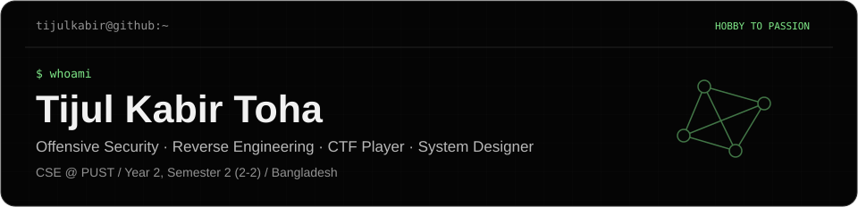
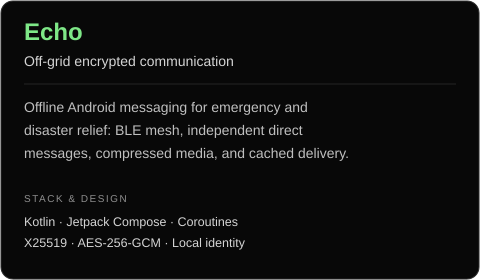
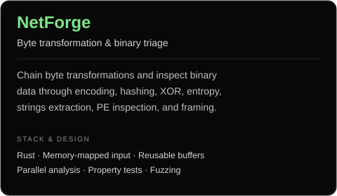
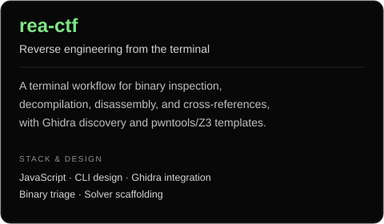
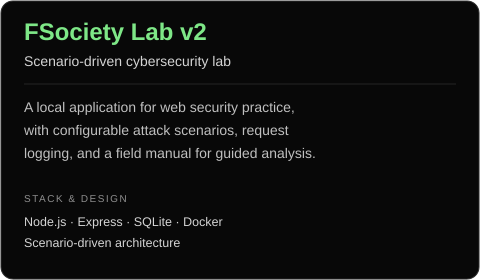
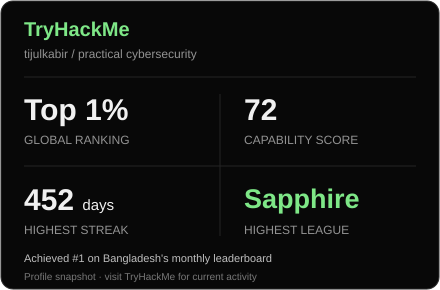

  

  
  
  

## About Me

I'm **Tijul Kabir Toha**, also known as **Froster**, a **Computer Science and Engineering undergraduate at Pabna University of Science and Technology (PUST)**, Bangladesh. I'm currently in **Year 2, Semester 2 (2-2)**.

I work across **offensive security, reverse engineering, and system design**, connecting low-level software analysis with the architecture and development of practical applications.

## CTF, Hackathons & System Design

As **Team Lead @ PUST_Intruders**, I compete in national CTFs with a focus on **reverse engineering** and **binary exploitation (pwn)**. My experience includes onsite national competition and collaboration with **Mayer_Doa Inc** as a reverse-engineering contributor.

I also compete in **national hackathons**, combining **system architecture, rapid prototyping, and team delivery**. My engineering work explores distributed communication, modular data pipelines, secure identity, and reliable operation under connectivity and resource constraints.

**Competitive programming:** **300+ Codeforces problems solved**, primarily in **C++** ([practice archive](https://github.com/tijulkabir/code-forces)).

[**Read my CTF writeups →**](https://github.com/tijulkabir/ctf-writeups)

## Featured Projects

<table>
<tr>
<td width="50%" valign="top">

</td>
<td width="50%" valign="top">

</td>
</tr>
<tr>
<td width="50%" valign="top">

</td>
<td width="50%" valign="top">

</td>
</tr>
</table>

Echo's core BLE transport builds on <a href="https://github.com/permissionlesstech/bitchat-android">bitchat-android</a>; rea-ctf extends the <a href="https://github.com/morluto/rea">REA analysis engine</a>.

## Competitive Profiles & Stats

<table>
<tr>
<td width="50%" align="center">
  
</td>
<td width="50%" align="center">
  
</td>
</tr>
</table>

  
  
  

## Selected Achievements

### Hackathons

| Event | Result |
| --- | --- |
| **July National Hackathon 2026 — Crisis Tech** | **Echo — 1st in engineering score · 4th overall**, with **Team Binary Bandits**; developed through a **72-hour build sprint** |
| **PSTU National Hackathon 2026** | Cleared the preliminaries and qualified among the **Top 50 finalists** |

### Capture the Flag

| Competition | Achievement |
| --- | --- |
| **EWU National Robofest 2026** | **16th nationally**; represented **PUST's first-ever onsite national CTF team** |
| **Integrated Hawkers Initial CTF 2026** | **35th place**, with **1,057 points** |
| **National CTF — PUST_Intruders** | **67th nationally**, with **1,186 points** |
| **DIU Cyber Security Club National CTF** | **78th place**, with **620 points**, representing **Persistent Undergrad Security Team** |
| **CUET StealthFlags 2025 — Televerse 1.0** | **82nd nationally**, with **1,550 points**, with **PUST_Intruders** |
| **BDSec CTF 2026** | **129th of 545 teams globally**, with **Mayer_Doa Inc**; focused on **reverse engineering**, with **all submitted RE solutions accepted** |
| **BDSec CTF 2025** | Competed with **PUST Intruders** |

### Competitive Programming

| Platform / Competition | Achievement |
| --- | --- |
| [**CodeChef**](https://www.codechef.com/users/tijulkabir) | **2-star programmer** |
| **Meta Hacker Cup 2025** | Qualified for **Round 1** |
| **Solver Fest 3.0** | Programming contest participation |

Additional event experience includes **Phoenix Summit 2026**, **IEEE PUST TechXplore 2026**, and TryHackMe's **Love at First Breach CTF**.

## Technologies & Tools

  

**Security & systems:** Binary analysis · Reverse engineering · Web security · Network analysis · BLE mesh networking 
**Engineering:** Jetpack Compose · PySide6 · SQLite · GitHub Actions · Cargo · Gradle · CMake

## Certifications & Training

- [**Certified Cybersecurity Educator Professional (CCEP)**](https://courses.redteamleaders.com/exam-completion/4ffef4a281d6b982) — Red Team Leaders.
- **Certified Phishing Prevention Specialist (CPPS)** — Hack & Fix.
- **TryHackMe:** Jr Penetration Tester, Web Fundamentals, and Pre Security learning paths.
- [**Data Structure & Algorithms Bootcamp**](https://media.geeksforgeeks.org/courses/certificates/850b636c8efc53d9c2105c71416c7514.pdf) — GeeksforGeeks.
- **Advent of Cyber 2023, 2024, and 2025**, plus **Hacker Holidays 2026** — TryHackMe.

## GitHub Analytics

  

## Connect

[**Portfolio**](https://tijulkabir.me) · [**LinkedIn**](https://www.linkedin.com/in/tijulkabir1/) · [**GitHub**](https://github.com/tijulkabir) · [**Email**](mailto:toha.240113@s.pust.ac.bd)

<em>Hobby to Passion.</em>

